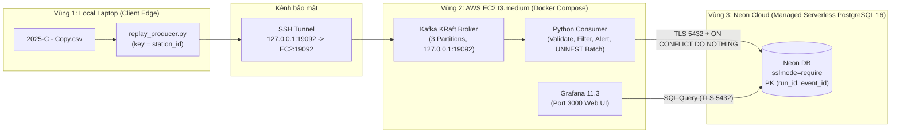

# Water Quality Cloud Monitoring Pipeline (Seminar & BTL — Nhóm 12, L01)

Hệ thống thu thập, kiểm định, cảnh báo ngưỡng và trực quan hóa dữ liệu quan trắc chất lượng nước theo thời gian thực trên nền tảng **AWS EC2 (IaaS) + Neon Serverless PostgreSQL (Managed DB)**, sử dụng dữ liệu thực tế năm 2025 từ UK Environment Agency (`environment.data.gov.uk/water-quality`, `177.319` bản ghi).

## Kiến trúc 3 phân vùng hạ tầng



## Cấu trúc thư mục

```text
water-quality-cloud/
├── compose.yaml                     # Stack chạy trên AWS EC2 (Kafka KRaft, Consumer, Grafana -> Neon)
├── compose.local.yaml               # Override chạy offline hoàn toàn bằng PostgreSQL Docker local
├── .env.example                     # Mẫu biến môi trường (12-Factor config)
├── db/
│   ├── schema.sql                   # Schema: water_measurements, rejected_events, pipeline_runs, ml_predictions
│   └── init_db.py                   # Script khởi tạo & kiểm tra bảng trên Neon PostgreSQL
├── producer/
│   ├── replay_producer.py           # Đọc CSV 2025, phát JSON vào Kafka với rate limiter & report JSON
│   └── requirements.txt
├── consumer/
│   ├── Dockerfile                   # Non-root Python 3.12 container
│   ├── requirements.txt
│   └── app/
│       ├── validator.py             # Lọc NO FLOW/SAMP, kiểm tra miền vật lý, gắn alert NORMAL/WARNING/CRITICAL
│       ├── db.py                    # Batch UNNEST + ON CONFLICT DO NOTHING + retry reconnect Neon
│       └── main.py                  # Kafka consumer manual commit + hook test crash (exit code 77)
├── grafana/provisioning/
│   ├── datasources/neon-postgres.yaml
│   └── dashboards/
│       ├── dashboards.yaml
│       └── json/water-quality-monitoring.json
├── benchmarks/
│   ├── evaluate_run.py              # Đo throughput, p50/p95/max latency, trùng lặp và Kafka lag
│   ├── generate_charts.py           # Sinh ảnh PNG dark-theme chuẩn slide từ JSON kết quả Cloud
│   └── run_seminar_benchmarks.ps1   # Tự động hóa 4 bài test Seminar qua SSH tunnel
├── tests/                           # Unit & smoke tests (pytest)
└── docs/
    ├── SEMINAR_ARCHITECTURE_AND_WORKFLOW_GUIDE.md # Giải thích chi tiết kiến trúc, workflow & công nghệ
    ├── CLOUD_VERIFICATION_REPORT.md     # Báo cáo số liệu đo thật trên AWS EC2 & Neon DB
    ├── DEPLOY_EC2_NEON_GUIDE.md         # Hướng dẫn triển khai từng bước lên Neon & AWS EC2 (<60 phút)
    ├── SEMINAR_ACTION_PLAN_AND_SLIDES.md # Kế hoạch 4 ngày, chia việc 5 người, sửa 12 slide & Q&A
    └── BTL_CLOUD_NATIVE_ROADMAP.md      # Lộ trình mở rộng BTL (Terraform, Elasticity, Secrets, ML Worker)
```

## Quickstart nhanh

### 1. Kiểm tra offline trên máy cá nhân (tùy chọn)

```powershell
cd water-quality-cloud
copy .env.example .env
docker compose -f compose.yaml -f compose.local.yaml up -d --build
python -m venv .venv
.\.venv\Scripts\pip install -r producer\requirements.txt -r benchmarks\requirements.txt
.\.venv\Scripts\python producer\replay_producer.py --rate 20 --max-events 200
```

Mở Grafana tại `http://localhost:3000` (user/password trong `.env`).

### 2. Triển khai thật lên AWS EC2 + Neon PostgreSQL

Xem hướng dẫn chi tiết từng lệnh copy-paste trong [DEPLOY_EC2_NEON_GUIDE.md](docs/DEPLOY_EC2_NEON_GUIDE.md).
