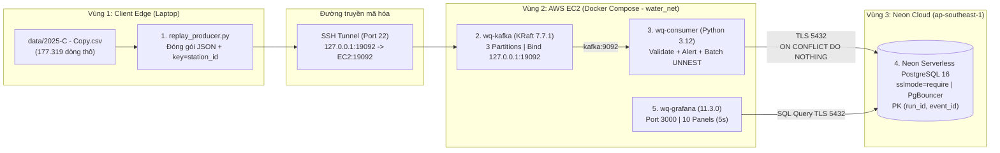
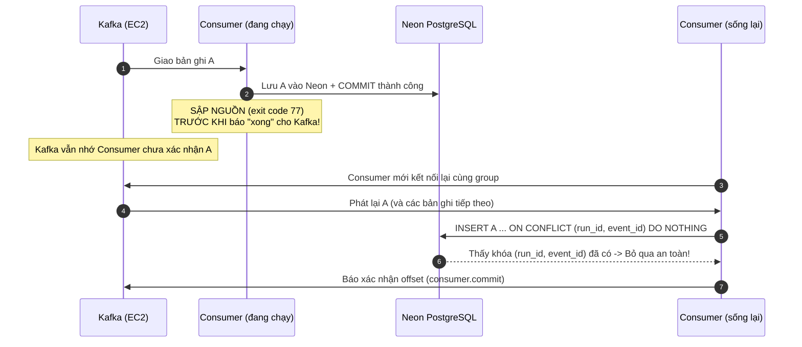

# Cẩm nang Nhập môn Toàn diện: Hiểu Hệ thống từ Số 0 & Đối chiếu 19 Slide Canva với Source Code

Tài liệu này viết cho **người mới hoàn toàn** (chưa cần biết trước về Cloud, Kafka, Docker hay PostgreSQL). Đọc xong tài liệu này, bạn sẽ nắm vững:
1. **Hệ thống đang giải quyết bài toán gì** bằng ví dụ đời thực dễ hình dung.
2. **Hành trình sống của từng dòng dữ liệu** từ file CSV đến biểu đồ Grafana.
3. **Vai trò từng công cụ** và điều gì sẽ vỡ nếu thiếu nó.
4. **Tại sao pipeline bắt buộc phải thiết kế như vậy** (hiểu gốc rễ 5 Quyết định Kiến trúc ADR-1 → ADR-5).
5. **Đối chiếu chi tiết từng slide trong bộ slide Canva (`DAHbuYdPunA`, 19 slides)** với **source code thực tế hiện tại** — chỗ nào khớp 100%, chỗ nào có chi tiết tinh tế cần chú ý khi bảo vệ.

> **Ghi chú bảo mật:** Tài liệu này nằm trong Git nên mọi địa chỉ IP, tên endpoint Neon và đường dẫn khóa SSH dùng ký hiệu thay thế (`<EC2_IP>`, `<NEON_HOST>`, `<PATH_TO_PEM>`).

---

## Phần 1 — Hệ thống này làm cái gì? (Giải thích bằng ví dụ đời thực)

### 1.1. Bài toán thực tế
Hãy tưởng tượng có **`7.371` trạm đo nước thải/sông ngòi** trên khắp nước Anh (dữ liệu thật năm 2025 của Cơ quan Môi trường Anh — UK Environment Agency, lưu tại `water-quality-cloud/data/2025-C - Copy.csv` với **`177.319` dòng** và **`483` chỉ tiêu**).

Dữ liệu thô ngoài thực địa có 3 đặc điểm rất "khó chịu":
1. **Mỗi dòng chỉ là 1 chỉ tiêu đơn lẻ tại 1 thời điểm:** Ví dụ cùng lúc `12:04:00` ở trạm `AN-011624`, hệ thống nhận 3 bản tin tách rời nhau cho `BOD ATU`, `Sld Sus@105C` và `Ammonia(N)`.
2. **Lẫn dữ liệu "rác/trạng thái" (`NO FLOW/SAMP`):** Có **`2.993` dòng** trạm cạn nước hoặc không lấy được mẫu (`unit = coded`, `result = 0`). Nếu đem `result = 0` đi tính trung bình chất lượng nước hoặc vẽ đồ thị chung, số liệu ô nhiễm sẽ bị sai lệch.
3. **Lưu lượng đổ về không đều:** Lúc bình thường chỉ 10–20 tin/giây, nhưng lúc nhiều trạm đồng loạt gửi (*burst*), lưu lượng có thể vọt lên 100 tin/giây trong khi cơ sở dữ liệu lại nằm ở một quốc gia khác qua mạng Internet.

**Mục tiêu của hệ thống:** Thu nhận liên tục luồng dữ liệu này, **lọc sạch nhiễu**, **phát hiện ngay mức cảnh báo ô nhiễm (`WARNING` / `CRITICAL`)**, lưu trữ **không mất — không trùng** kể cả khi phần mềm sập giữa chừng, và **vẽ lên màn hình theo dõi trực tiếp mỗi 5 giây**.

---

### 1.2. Hình dung toàn hệ thống bằng phép ẩn dụ "Nhà máy chuyển phát dữ liệu"

Nếu coi hệ thống như một dây chuyền ngoài đời thực, nó gồm đúng **6 mắt xích**:

| Ngoài đời thực | Trong hệ thống Cloud của bạn | Vai trò chính |
| :--- | :--- | :--- |
| **1. Cảm biến / Trạm thu gom tại hiện trường** | **Laptop Edge** (`producer/replay_producer.py`) | Đọc từng dòng CSV 2025, đóng gói thành hộp JSON chuẩn và phát đi theo tốc độ `--rate`. |
| **2. Đường hầm xe bọc thép** | **SSH Tunnel** (`Port 22` → `127.0.0.1:19092`) | Bọc kín gói tin khi đi qua mạng Internet công cộng để người ngoài không nghe lén hay giả mạo dữ liệu gửi vào. |
| **3. Nhà xưởng trên Cloud (thuê hạ tầng)** | **AWS EC2 `c7i-flex.large`** + **Docker Compose** | Máy chủ Linux đặt trên mây AWS (`ap-southeast-2` Sydney), nơi chứa gọn 3 cỗ máy chính: Kafka, Consumer và Grafana. |
| **4. Băng chuyền & Kho đệm thông minh** | **Apache Kafka KRaft** (`wq-kafka`, `3 partitions`) | Nhận hàng cực nhanh, xếp đúng thứ tự theo từng trạm (`station_id`), giữ tạm an toàn trên đĩa nếu nhân viên xử lý phía sau bị chậm hoặc tạm tắt. |
| **5. Nhân viên kiểm định & đóng thùng** | **Python Consumer** (`consumer/app/`) | Lấy hàng từ băng chuyền, vứt hộp rỗng/hỏng (`NO FLOW/SAMP`) sang thùng riêng, dán tem `NORMAL`/`WARNING`/`CRITICAL`, gom **100 hộp vào 1 xe tải (`UNNEST` batch)** rồi mới chở qua cầu Internet tới kho chính. |
| **6. Kho lưu trữ thuê ngoài + Màn hình TV giám sát** | **Neon Serverless PostgreSQL 16** + **Grafana 11.3** | Neon (`ap-southeast-1` Singapore) giữ dữ liệu vĩnh viễn dù máy chủ EC2 tắt; Grafana nối vào Neon để vẽ 10 biểu đồ trực tiếp mỗi 5 giây. |

### 1.3. Sơ đồ tổng thể 3 Phân vùng & 5 Bước

---

## Phần 2 — Hành trình sống của 1 dòng dữ liệu (Từ CSV đến Grafana)

Hãy theo dấu **2 dòng dữ liệu có thật** trong `data/2025-C - Copy.csv` (cũng có sẵn trong file mẫu `data/2025-C_sample.csv`) đi xuyên suốt hệ thống:

### Trường hợp A — Dòng đo lường HỢP LỆ (`BOD ATU`)
Dòng gốc trong CSV tại trạm `AN-011624`:
- `@id`: `.../measurement/AN-2089657-0085`
- `sample.samplingPoint.notation`: `AN-011624`
- `sample.sampleDateTime`: `2025-01-13T12:04:00`
- `determinand.label`: `BOD ATU`, `result`: `4`, `unit`: `mg/l`

**Đi qua 5 chặng như sau:**
1. **Producer (`replay_producer.py`):**
   - Thấy `BOD ATU` nằm trong nhóm 8 nhãn cốt lõi (`CORE_DETERMINANDS`) nên giữ lại.
   - Cắt đuôi `@id` làm `event_id = "AN-2089657-0085"`, gắn `run_id = "demo-live"`, gắn `station_id = "AN-011624"` làm **Kafka key**, chuẩn hóa `event_time = "2025-01-13T12:04:00Z"`, và đóng dấu **`produced_at`** = giờ UTC ngay lúc gửi.
   - Đẩy JSON vào `127.0.0.1:19092` (đi qua SSH Tunnel lên EC2).
2. **Kafka (`wq-kafka`):**
   - Băm chữ `"AN-011624"` để chọn cố định 1 trong 3 partitions (`0`, `1` hoặc `2`). Nhờ vậy mọi bản tin sau này của trạm `AN-011624` luôn xếp hàng ngay ngắn theo đúng thứ tự thời gian.
3. **Consumer kiểm định (`consumer/app/validator.py`):**
   - Kiểm tra đủ 6 trường bắt buộc (`run_id`, `event_id`, `station_id`, `determinand`, `event_time`, `produced_at`).
   - Kiểm tra `4` là số thực hợp lệ, không âm, không phải `NO FLOW/SAMP`.
   - Tra bảng ngưỡng `THRESHOLDS["BOD ATU"]` (`> 25` là `WARNING`, `> 50` là `CRITICAL`) → gắn **`alert_level = "NORMAL"`**.
4. **Consumer ghi DB theo lô (`consumer/app/db.py`):**
   - Gom đủ 100 tin (hoặc hết `500 ms`) rồi dùng câu lệnh SQL `UNNEST` chèn cả lô vào bảng **`water_measurements`** trong **1 transaction duy nhất**.
   - PostgreSQL/Neon tự đóng dấu **`ingested_at = clock_timestamp()`** ngay lúc lưu xuống đĩa.
   - Chỉ sau khi DB `COMMIT` xong xuôi, Consumer mới báo cho Kafka: *"Tôi xử lý xong tới vị trí offset này rồi"* (`consumer.commit(asynchronous=False)`).
5. **Grafana (`wq-grafana`):**
   - Mỗi 5 giây, Grafana chạy SQL hỏi Neon DB: đếm tổng số dòng, vẽ đường throughput, lấy `ingested_at - produced_at` để ra **End-to-End Latency**, và đưa dòng của trạm `AN-011624` lên bảng *Latest Ingested Water-Quality Events*.

### Trường hợp B — Dòng NHIỄU trạng thái (`NO FLOW/SAMP`)
Dòng gốc trong CSV tại trạm `AN-011638`:
- `@id`: `.../measurement/AN-2095170-7668`
- `determinand.label`: `NO FLOW/SAMP`, `result`: `0`, `determinand.unit.label`: `coded`

**Điều gì xảy ra?**
- Producer vẫn đóng gói và gửi lên Kafka (để tái hiện đúng dữ liệu bẩn từ hiện trường).
- Tới Consumer (`validator.py`), dòng này chạm đúng điều kiện `determinand == "NO FLOW/SAMP" or unit.lower() == "coded"` → **bị từ chối** với lý do **`NON_MEASUREMENT_CODED`**.
- Thay vì vứt bỏ mất dấu vết, `db.py` lưu nó vào bảng riêng **`rejected_events`** (giữ nguyên toàn bộ gói tin gốc ở cột `raw_payload` dạng `JSONB`).
- Trên Grafana, nó làm tăng ô **Rejected / Noise Events** mà **không làm bẩn** các biểu đồ nồng độ nước ở bảng `water_measurements`.

### Vì sao hệ thống tách 3 mốc thời gian?
| Mốc thời gian | Sinh ra ở đâu? | Ý nghĩa dễ hiểu |
| :--- | :--- | :--- |
| **`event_time`** | Trong file CSV (năm 2025) | Ngày giờ nhân viên/cảm biến lấy mẫu nước ngoài thực địa. Dùng vẽ biểu đồ phân bố theo tháng `2025-01..09`. |
| **`produced_at`** | Laptop Producer lúc bấm gửi | Thời điểm gói tin bắt đầu bước vào đường ống Cloud. |
| **`ingested_at`** | Neon DB (`clock_timestamp()`) | Thời điểm gói tin nằm an toàn trong DB. Lấy **`ingested_at - produced_at`** sẽ đo được chính xác **tốc độ xử lý thực tế (End-to-End Latency)** của cả hệ thống Cloud. |

---

## Phần 3 — Vai trò từng công cụ (và "Nếu bỏ đi thì hệ thống vỡ ở đâu?")

| Thành phần / Công cụ | File trong repo | Tác dụng chính | Nếu bỏ đi hoặc thay bừa thì sao? |
| :--- | :--- | :--- | :--- |
| **1. Python Producer** | `producer/replay_producer.py` | Giả lập cảm biến: đọc CSV, lọc 8 nhãn chính, điều tiết tốc độ `--rate` (`10..100/s`), nén `lz4`, chờ broker xác nhận `acks=all`. | Không có nguồn phát dữ liệu chuẩn theo tốc độ để kiểm chứng chịu tải burst hay độ trễ WAN. |
| **2. SSH Tunnel + Security Group** | `compose.yaml` (`127.0.0.1:19092`) | Mã hóa luồng Producer → EC2 qua cổng SSH `22`; Security Group chỉ mở `22` và `3000`. | Nếu mở thẳng cổng Kafka `9092/19092` PLAINTEXT ra Internet, bất kỳ ai quét IP cũng có thể đọc trộm hoặc bơm dữ liệu rác phá DB. |
| **3. AWS EC2 (`c7i-flex.large`)** | Hạ tầng Cloud IaaS (`2 vCPU, 4 GiB RAM`) | Cung cấp máy chủ Linux độc lập chạy cả Kafka + Consumer + Grafana gần nhau qua mạng bridge nội bộ. | Nếu chọn `t3.micro` (`1 GiB RAM`), Kafka JVM rất dễ bị hệ điều hành giết tiến trình (OOM kill). |
| **4. Docker & Docker Compose** | `compose.yaml`, `compose.local.yaml`, `consumer/Dockerfile` | Đóng gói đồng nhất mọi dịch vụ, tách mạng nội bộ `water_net`, chạy Consumer bằng user `appuser` (non-root), chuyển đổi Online ↔ Offline không sửa code. | Cài tay trực tiếp lên Ubuntu dễ xung đột phiên bản Python/Java, khó dựng lại nhanh và khó tách môi trường local/cloud. |
| **5. Apache Kafka 7.7.1 (KRaft)** | `compose.yaml` (`wq-kafka`, `wq-kafka-init`) | Hàng đợi sự kiện bền vững trên đĩa EBS; chia `3 partitions` theo `station_id`; dùng chế độ KRaft bỏ ZooKeeper để tiết kiệm RAM. | Nếu bỏ Kafka cho Producer ghi thẳng DB: khi DB chậm hoặc mạng chập chờn, Producer bị treo theo hoặc làm mất dữ liệu lúc burst tải. |
| **6. Python Consumer** | `consumer/app/main.py`, `validator.py`, `db.py` | Bộ não xử lý luồng (Stream ETL): lọc nhiễu, kiểm tra miền vật lý, gắn nhãn cảnh báo, gom batch `UNNEST`, retry khi Neon ngủ, manual offset commit. | Không có nơi làm sạch dữ liệu bẩn, không gắn cảnh báo tự động và không gom batch được để vượt độ trễ WAN. |
| **7. Neon Serverless PostgreSQL 16** | `db/schema.sql`, `db/init_db.py` | Kho lưu trữ Managed DB nằm ngoài EC2; tự ngủ sau 5 phút không dùng (`$0/tháng` Free Tier); bắt buộc TLS; có PgBouncer pooling (`prepare_threshold=None`). | Nếu cài Postgres chung trên EC2: tắt/hỏng EC2 là mất/kẹt dữ liệu, tranh RAM với Kafka, và không đo được độ trễ mạng WAN thật. |
| **8. Grafana 11.3** | `grafana/provisioning/` | Tự động nạp datasource và dashboard 10 panels bằng code (`YAML + JSON`), cập nhật mỗi 5 giây trực tiếp từ SQL Neon. | Phải chạy câu lệnh SQL bằng tay để xem dữ liệu; mỗi lần dựng lại EC2 phải bấm chuột cấu hình biểu đồ lại từ đầu. |

---

## Phần 4 — TẠI SAO Pipeline PHẢI thiết kế như vậy? (7 câu hỏi "Tại sao" cốt lõi)

### 4.1. Tại sao không để Producer ghi thẳng vào Neon DB mà phải đi vòng qua Kafka? (ADR-2)
- Nếu Producer ghi thẳng vào DB: khi 100 gói/giây đổ tới cùng lúc hoặc Neon đang ngủ mất 1–2 giây khởi động lại, toàn bộ trạm gửi bên ngoài sẽ bị nghẽn hoặc văng lỗi mất gói tin.
- Khi đặt **Kafka** ở giữa, Producer chỉ cần đẩy xong vào Kafka trên EC2 (mất vài mili-giây) là rảnh tay. Kafka lưu an toàn xuống đĩa làm **vùng đệm (buffer)** — kể cả lúc Consumer bị tắt hoặc chạy chậm (`single` mất tới ~5 phút mới ghi xong `1.000` tin), dữ liệu vẫn nằm nguyên trong Kafka không rơi một dòng nào.

### 4.2. Tại sao lại tách làm 3 phân vùng (Laptop – EC2 – Neon) thay vì cài Postgres luôn trong EC2? (ADR-1 & ADR-3)
- **Tách Compute và State (Stateless Compute vs Stateful Storage):** Trong kiến trúc Cloud chuẩn, máy tính xử lý (EC2) có thể bật/tắt/hỏng bất cứ lúc nào, còn dữ liệu phải nằm ở dịch vụ lưu trữ bền vững độc lập (Neon Managed DB).
- **Tránh tranh chấp tài nguyên & tiết kiệm tiền:** EC2 chỉ có `4 GiB` RAM, chia cho Kafka + Consumer + Grafana là vừa đẹp. Dùng Neon Free Tier (`auto-suspend 5 phút`) giúp lưu trữ lâu dài với `$0/tháng`, lại giúp nhóm đo được **bài toán độ trễ WAN thật** giữa máy chủ tính toán và cơ sở dữ liệu đặt khác vùng.

### 4.3. Tại sao làm sạch dữ liệu trên Cloud (`wq-consumer`) chứ không lọc hết ở Laptop (`replay_producer.py`)? Bước này có phải Serverless không?
- **Tại sao lọc trên Cloud:** Trong thực tế IoT, không ai muốn mỗi lần thay đổi ngưỡng cảnh báo (`BOD > 25`) hay luật lọc nhiễu lại phải cập nhật phần mềm cho `7.371` trạm ngoài thực địa. Đẩy nguyên bản tin về Cloud giúp:
  1. Cập nhật luật lọc/ngưỡng tập trung tại 1 chỗ (`validator.py`).
  2. Vẫn lưu lại các dòng `NO FLOW/SAMP` vào bảng `rejected_events` để kỹ sư biết trạm nào đang cạn nước hoặc hỏng cảm biến.
- **Có phải Serverless không?** **Không.** `wq-consumer` là **container chạy liên tục trên EC2 (IaaS)** để giữ kết nối bền với Kafka và gom batch 100 dòng mà không bị độ trễ khởi động (cold-start). Thành phần Serverless thực sự trong hệ thống hiện tại là **Neon Serverless PostgreSQL** ở tầng DB.

### 4.4. Tại sao phải gom Batch `UNNEST` (100 dòng/lô) thay vì ghi từng dòng? (ADR-4 — Bài học đắt giá nhất của đồ án)
Hãy tưởng tượng bạn cần chuyển **1.000 viên gạch** qua cây cầu bắc giữa hai thành phố (**EC2 Sydney ↔ Neon Singapore**), mỗi lượt qua cầu đi về tốn **~300 ms**:
- **Cách `single` (chở từng viên một):** Mỗi viên gạch chạy 1 chuyến xe qua cầu → 1.000 chuyến × 0,3 giây ≈ **~300 giây (5 phút!)**, chỉ chuyển được **~3 viên/giây**!
- **Cách `batch=100` (`UNNEST`):** Xếp **100 viên lên 1 xe tải** bằng mảng `unnest(%s::text[], ...)` rồi qua cầu **10 chuyến duy nhất** → xong hết trong **~6–7 giây**!

Số liệu đo thật trên Cloud chứng minh điều này:
- Đợt `23/11/2026`: Single `3.01 evt/s` (`p95 = 316.98 s`) vs Batch `150.65 evt/s` (`p95 = 4.47 s`) → **nhanh gấp ~50×, p95 giảm ~71×**.
- Đợt `25/11/2026`: Single `3.50 evt/s` (`p95 = 269.24 s`) vs Batch `133.99 evt/s` (`p95 = 3.44 s`) → **nhanh gấp ~38×, p95 giảm ~78×**.

### 4.5. Tại sao phải tắt `auto.commit`, ghi DB trước – commit Kafka sau, và dùng `ON CONFLICT DO NOTHING`? (ADR-4)
Trong hệ thống phân tán, điều đáng sợ nhất là **Consumer sập nguồn đúng lúc đang chạy dở**. Nếu bật `auto.commit=True`, Kafka đánh dấu "xong rồi" trước khi DB kịp lưu → sập nguồn là **mất dữ liệu vĩnh viễn**.

Hệ thống của bạn giải quyết bằng cơ chế **At-Least-Once Delivery + Idempotent Write**:

**Kết quả:** Có sập giữa chừng thì dữ liệu cũng **không bị mất**, khi phát lại thì Neon tự động chặn trùng → **0 mất, 0 trùng**!

### 4.6. Tại sao khóa cứng Kafka ở `127.0.0.1:19092` và dùng SSH Tunnel? (ADR-5)
- Mặc định nếu mở cổng Kafka `9092/19092` với giao thức `PLAINTEXT` ra ngoài Internet (`0.0.0.0`), bất kỳ ai cũng có thể gửi tin giả hoặc phá hỏng dữ liệu nếu chưa dựng hệ thống chứng chỉ TLS/SASL phức tạp cho Kafka.
- Giải pháp của nhóm: trong `compose.yaml`, cổng ngoài của Kafka chỉ nghe nội bộ loopback `127.0.0.1:19092` của máy EC2, còn Security Group chặn hết `9092/19092`. Laptop từ nhà muốn gửi vào chỉ việc mở **SSH Tunnel** qua cổng `22` (đã mã hóa sẵn bằng khóa `.pem`). Vừa an toàn tuyệt đối, vừa không phải cấu hình TLS phức tạp cho Kafka ở pha Seminar.

### 4.7. Tại sao cùng 1 bộ code lại chạy được cả Offline và Online?
- Mọi địa chỉ kết nối (`DATABASE_URL`, `KAFKA_BOOTSTRAP_SERVERS`, `CONSUMER_MODE`, `PG_SSLMODE`) đều đọc từ biến môi trường (chuẩn **12-Factor App**).
- Khi chạy **Offline** (`docker compose -f compose.yaml -f compose.local.yaml up -d`), file `compose.local.yaml` tự chèn thêm container `postgres:16-alpine` nội bộ và ghi đè biến kết nối từ Neon sang Postgres local. Mã Python không phải sửa lấy 1 chữ!

---

## Phần 5 — Đối chiếu chi tiết Bộ Slide Canva (`DAHbuYdPunA`, 19 Slides) với Source Code hiện tại

Tôi đã đọc toàn bộ **19 slide và phần ghi chú thuyết trình (presenter notes)** trong bộ slide Canva của bạn và so khớp trực tiếp với từng file code trong `water-quality-cloud/`.

### 5.1. Bảng đối chiếu từng Slide (Slide 1 → Slide 19)

| Slide | Tiêu đề trên Canva | Nội dung chính & Người trình bày | Ánh xạ trực tiếp trong Source Code | Trạng thái khớp |
| :---: | :--- | :--- | :--- | :---: |
| **1** | **Giám sát chất lượng nước Thời gian thực trên Cloud** | Tên đề tài, GVHD Nguyễn Quang Hùng, 5 thành viên Nhóm 12 - L01 (*TV1*) | [README.md](../README.md) | **Khớp 100%** *(lỗi typo tên thành viên trước đây đã sửa đúng: Trần Trường Sinh)* |
| **2** | **Mục tiêu Seminar & Định vị BTL** | Seminar: phân tích công cụ + 5 ADR + số liệu thật; BTL (12/12): tối ưu chính pipeline (`ap-southeast-1`, sweep, tách trễ, DLQ, `k3s + KEDA`, Terraform) (*TV1*) | Định vị tổng thể trong toàn repo & `db/schema.sql` | **Cần chỉnh nhẹ Canva** *(đã chốt BTL gọn còn Nhóm 1 & 2 trong [BTL_CLOUD_NATIVE_ROADMAP.md](./BTL_CLOUD_NATIVE_ROADMAP.md), bỏ Nhóm 3)* |
| **3** | **Nội dung Trình bày** | 6 phần bố cục 19 slides (*TV1*) | Khớp cấu trúc dự án | **Khớp 100%** |
| **4** | **Dữ liệu 2025 & Yêu cầu Kiến trúc** | `177.319` dòng, `7.371` trạm, `483` chỉ tiêu; 7 chỉ tiêu chính + `2.993` `NO FLOW/SAMP`; 5 NFRs (*TV1*) | Đã kiểm chứng trực tiếp từ `data/2025-C - Copy.csv` và `CORE_DETERMINANDS` trong [replay_producer.py](../producer/replay_producer.py) | **Khớp tuyệt đối đến từng con số** |
| **5** | **Phân tích Tầng Compute (ADR-1)** | Chọn AWS EC2 `c7i-flex.large` + Docker Compose vs ECS Fargate/EKS vs Lambda ETL (*TV2*) | [compose.yaml](../compose.yaml), [consumer/Dockerfile](../consumer/Dockerfile) | **Khớp 100%** |
| **6** | **Phân tích Broker: Kafka KRaft (ADR-2)** | Chọn Kafka KRaft 7.7.1 (`3 partitions`, `key = station_id`, heap `512–768m`) vs RabbitMQ vs Kafka+ZK/MSK (*TV2*) | [compose.yaml](../compose.yaml) (`KAFKA_HEAP_OPTS: "-Xms512m -Xmx768m"`, `KAFKA_PARTITIONS=3`), [replay_producer.py](../producer/replay_producer.py) | **Khớp 100%** |
| **7** | **Phân tích Lưu trữ: Neon DB (ADR-3)** | Chọn Neon PostgreSQL 16 (`ap-southeast-1`, `PK(run_id, event_id)`, `sslmode=require`, `prepare_threshold=None`) vs Postgres trên EC2 vs RDS/Aurora (*TV2*) | [db/schema.sql](../db/schema.sql), [db/init_db.py](../db/init_db.py), [consumer/app/db.py](../consumer/app/db.py) | **Khớp 100%** |
| **8** | **Chiến lược Ghi WAN & Tin cậy (ADR-4)** | Batch `UNNEST` (`100 / 500 ms`) + tắt `auto.commit` + `ON CONFLICT DO NOTHING` (*TV3*) | [consumer/app/main.py](../consumer/app/main.py) (`enable.auto.commit=False`, `batch=100`, `500 ms`), [consumer/app/db.py](../consumer/app/db.py) (`UNNEST`) | **Khớp 100%** |
| **9** | **Quan sát & Bảo mật Edge (ADR-5)** | Grafana 11.3 tự host Dashboard-as-Code + khóa `127.0.0.1:19092` qua SSH Tunnel + `.env` + non-root `appuser` (*TV3*) | [compose.yaml](../compose.yaml), [grafana/provisioning/](../grafana/provisioning/), [consumer/Dockerfile](../consumer/Dockerfile) (`USER appuser`) | **Khớp 100%** |
| **10** | **Kiến trúc Tổng thể 3 Phân vùng** | Sơ đồ 3 vùng Edge – EC2 – Neon (*TV3*) | [benchmarks/generate_canva_assets.py](../benchmarks/generate_canva_assets.py) (`render_arch_3zone_light`) | **Khớp 100%** |
| **11** | **Luồng Xử lý 5 Bước & Schema Dữ liệu** | 4 bảng Neon, 3 mốc thời gian, kiểm `pH (0–14)`, `Temp (-5..60°C)`, 7 ngưỡng cảnh báo (*TV3*) | [db/schema.sql](../db/schema.sql) *(hiện đã rút gọn còn `3` bảng)*, [consumer/app/validator.py](../consumer/app/validator.py) | **Cần sửa số `4 → 3` bảng trên Slide 11** |
| **12** | **Thiết lập Thực nghiệm trên Cloud** | Hạ tầng 23/11 (`c7i-flex.large` Sydney + Neon Singapore) + 4 kịch bản Test 1–4 (*TV4*) | [benchmarks/run_seminar_benchmarks.ps1](../benchmarks/run_seminar_benchmarks.ps1), [benchmarks/evaluate_run.py](../benchmarks/evaluate_run.py) | **Khớp 100%** |
| **13** | **Kết quả 1: Đo tải Cloud & Nút thắt WAN** | Burst (`9.81 / 47.10 / 88.45/s`, `p95 3.71–3.99s`) & WAN (`150.65` vs `3.01/s`, `p95 4.47` vs `316.98s`) (*TV4*) | Số liệu thật trong `benchmarks/results/*20261123-06*` và `canva_throughput_light.png` | **Khớp số liệu 23/11** *(lưu ý có thêm bản chạy 25/11 — xem Mục 5.2)* |
| **14** | **Kết quả 2: Phục hồi Crash & Chống trùng** | `crash-recovery-20261123-065531`: ghi `AN-2095170-7668` (`NO FLOW/SAMP`) vào `rejected_events` → `exit code 77` → restart → thêm `25/26` nhiễu + `74/74` hợp lệ = `100`, `0` trùng, `lag = 0` (*TV4*) | Logic `os._exit(77)` trong [consumer/app/main.py](../consumer/app/main.py) và JSON `crash-recovery-20261123-065531.json` | **Khớp chính xác tuyệt đối** |
| **15** | **Kết quả 3: Bảo mật & Chi phí Thực tế** | `Test-NetConnection` (`3000` True, `19092/9092` False) tại IP thử nghiệm 23/11 + chi phí AWS Free Plan & Neon Free Tier (*TV4*) | [compose.yaml](../compose.yaml), `CLOUD_VERIFICATION_REPORT.md` | **Khớp 100%** *(lưu ý IP EC2 đổi mỗi lần Stop/Start)* |
| **16** | **Kết quả 4: Dashboard Grafana 11.3 Live** | 10/10 panel, `2.45 K (2.453)` hợp lệ, `647` nhiễu, `207` cảnh báo, 2025-01..09, refresh `5s` (*TV5*) | [grafana/provisioning/dashboards/json/water-quality-monitoring.json](../grafana/provisioning/dashboards/json/water-quality-monitoring.json) & `grafana_live_dashboard.png` | **Khớp 100%** |
| **17** | **Đánh giá: Điểm mạnh & Giới hạn** | Điểm mạnh + 4 giới hạn: Cross-region RTT, 1 EC2/1 Consumer tĩnh, đo trễ chéo đồng hồ & chưa ghi `pipeline_runs`, chưa Terraform/DLQ/metrics CPU-Lag (*TV5*) | Đúng thực tế code: `pipeline_runs` có trong `schema.sql` nhưng `db.py` chưa `INSERT` vào | **Trung thực & khớp 100%** |
| **18** | **Kế hoạch Tối ưu Pipeline cho BTL** | 4 trụ cột: same-region `ap-southeast-1` + sweep; tách 3 chặng trễ + `pipeline_runs` + DLQ + log dedup `rejected_events`; scale `1→3` (`6` partitions) + `k3s+KEDA`; Terraform + SSM + Prometheus + FastAPI + Lambda + SQL View (*TV5*) | Khớp hoàn toàn với những điểm còn mở trong code hiện tại | **Rất sắc nét & hợp lý** |
| **19** | **Cảm ơn & Hỏi đáp (Q&A)** | 2 kết luận cốt lõi + 6 tài liệu tham khảo (*TV5*) | Khớp tài liệu nghiên cứu gốc trong workspace | **Khớp 100%** |

---

### 5.2. 6 điểm tinh tế bạn cần biết khi đối chiếu Slide với Source Code

1. **Vị trí file CSV trong code đã được dời gọn vào `data/`:**
   - Sau ngày 23/11, file CSV được copy vào `water-quality-cloud/data/2025-C - Copy.csv` và `replay_producer.py` đọc trực tiếp từ `data/` (`177.319` dòng giữ nguyên 100%).
2. **Schema đã dọn gọn còn `3` bảng (`pipeline_runs` đang ở trạng thái bảng chờ cho BTL):**
   - Ngày `26/11/2026`, bảng chờ `ml_predictions` đã được gỡ khỏi `db/schema.sql`, `db/init_db.py` và Neon DB để schema gọn đúng **`3` bảng**: `water_measurements`, `rejected_events`, `pipeline_runs`. Hiện `consumer/app/db.py` ghi vào 2 bảng đầu, còn `pipeline_runs` sẽ được ghi tự động ở pha BTL (Nhóm 1).
3. **Chi tiết nhỏ về log `DEDUP_REPLAY` trong bài Crash Recovery (Slide 14 & Slide 18):**
   - Trong `consumer/app/main.py` (dòng 162), log `DEDUP_REPLAY` chỉ in ra khi `deduped_valid > 0` (tức bản ghi bị replay thuộc bảng `water_measurements`).
   - Ở bài test thật trên Slide 14, bản ghi đầu tiên `AN-2095170-7668` là dòng `NO FLOW/SAMP` (thuộc `rejected_events`), nên khi restart nó vẫn được `ON CONFLICT DO NOTHING` chặn trùng và `BATCH_COMMITTED` giảm `inserted_rejected` từ `26` xuống `25`, nhưng không in dòng `DEDUP_REPLAY`. **Slide 14 (ghi chú diễn giả) và Slide 18 (*"log dedup cho `rejected_events`"*) đã phản ánh rất chuẩn chi tiết code này.**
4. **Repo hiện có 2 đợt số liệu đo thật trên Cloud (`23/11/2026` và `25/11/2026`):**
   - Slide 13, 14, 16 trên Canva dùng số liệu chuẩn của đợt đo đầu ngày **`23/11/2026`** (`150.65` vs `3.01 evt/s`, `p95` `4.47 s` vs `316.98 s`, `2.453` bản ghi trên Grafana).
   - Ngày **`25/11/2026`**, bạn đã chạy lại trọn bộ kiểm chứng thêm 1 lần nữa (`133.99` vs `3.50 evt/s`, `p95` `3.44 s` vs `269.24 s`, crash recovery `0` trùng, `lag = 0`) — xu hướng giống hệt nhau. *(Lưu ý: các ảnh PNG trong `benchmarks/charts/` hiện dùng số liệu của đợt `25/11/2026`.)*
5. **Checklist chỉnh sửa nhanh 5 chỗ trên bộ Slide Canva (`DAHbuYdPunA`) cho khớp bản clean ngày `26/11`:**
   - **Slide 2 & Slide 18:** Gỡ bỏ các mục Nhóm 3 (`k3s + KEDA`, `Terraform + SSM`, `Prometheus/cAdvisor/Kafka Exporter`), chỉ giữ lại phạm vi BTL **Nhóm 1 & 2** (*đồng vùng `ap-southeast-1` + sweep, ghi `pipeline_runs` + log dedup `rejected_events`, SQL View theo trạm, AWS Lambda cảnh báo `CRITICAL`, và FastAPI HTTPS*).
   - **Slide 5 (ghi chú dưới cùng):** Thay *"nâng lên `k3s + KEDA` ở BTL"* thành *"tối ưu cùng vùng `ap-southeast-1` và scale Docker Compose khi cần ở BTL"*.
   - **Slide 11:** Sửa `Schema Neon (4 bảng)` thành **`Schema Neon (3 bảng)`** (gỡ `ml_predictions`).
   - **Slide 17:** Sửa dòng *"chưa có Terraform/DLQ & metrics CPU/Lag trên Grafana"* thành *"chưa tách độ trễ 3 chặng & chưa tự động ghi bảng `pipeline_runs`"*.
6. **IP Public trên Slide 15 là IP tại thời điểm kiểm thử `23/11/2026`:**
   - Vì EC2 không gắn Elastic IP cố định, mỗi lần bạn **Stop → Start** lại EC2, AWS sẽ cấp một Public IPv4 mới (khi thuyết trình chỉ cần mở URL `http://<EC2_IP_MOI>:3000/d/wq-cloud-n12-l01`).

---

## Phần 6 — Tóm tắt "bỏ túi" 60 giây cho người mới

Nếu ai đó hỏi bạn **"Hệ thống của bạn chạy như thế nào và có gì hay?"**, bạn chỉ cần nhớ 4 ý cốt lõi sau:

1. **Đầu vào & Bảo mật:** Laptop đóng vai trò thiết bị biên đọc dữ liệu quan trắc năm 2025 (`2025-C - Copy.csv`), đẩy JSON qua **SSH Tunnel** vào **Kafka KRaft (3 partitions)** đặt trên **AWS EC2** (cổng Kafka khóa cứng ở `127.0.0.1`, người ngoài không chạm vào được).
2. **Làm sạch & Cảnh báo trên luồng:** **Python Consumer** trên EC2 lọc bỏ các dòng nhiễu `NO FLOW/SAMP` sang bảng `rejected_events`, kiểm tra miền vật lý, gắn nhãn `NORMAL` / `WARNING` / `CRITICAL` cho 7 chỉ tiêu và lưu vào bảng `water_measurements`.
3. **Vượt nút thắt Cloud WAN & Chống mất/trùng:** Nhờ gom **100 dòng vào 1 lệnh `UNNEST`** thay vì commit từng dòng qua Internet tới **Neon PostgreSQL**, tốc độ ghi tăng **~38–50 lần**; kết hợp tắt `auto.commit` + ghi DB trước, commit Kafka sau + `ON CONFLICT DO NOTHING` giúp đạt **0 mất, 0 trùng** khi crash (`exit code 77`).
4. **Tách trạng thái & Giám sát:** Dữ liệu nằm bền vững trên **Neon Serverless DB** (`auto-suspend 5 phút`, `$0`), còn **Grafana 11.3** tự host trên EC2 đọc SQL trực tiếp và cập nhật **10 biểu đồ mỗi 5 giây**.
