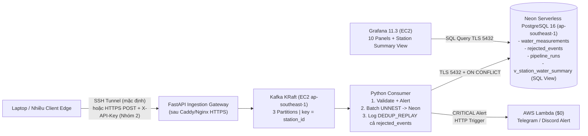

# Lộ trình Bài tập lớn (BTL — Hạn nộp 12/12/2026): Tối ưu Pipeline Cloud (Nhóm 1 & Nhóm 2)

Tài liệu này chốt **phạm vi thực tế và khả thi** để chuyển tiếp từ **Seminar MVP (`water-quality-cloud/`)** lên **Bài tập lớn (12/12/2026)**. Để phù hợp quỹ thời gian của nhóm, BTL tập trung tối ưu sâu chính pipeline hiện tại theo **2 nhóm hạng mục** (chủ động cắt bỏ các phần vận hành nặng).

---

## Kiến trúc mục tiêu cho BTL

---

## Nhóm 1 — Ưu tiên cao (Bắt buộc hoàn thành, ~2–3 giờ)

### 1.1. SQL View tổng hợp chất lượng nước theo trạm
- Bổ sung `CREATE OR REPLACE VIEW v_station_water_summary AS ...` vào `db/schema.sql`.
- Tự động tổng hợp theo từng `station_id` (`station_name`): tổng số mẫu hợp lệ, giá trị trung bình / lớn nhất theo từng chỉ tiêu (`BOD ATU`, `Ammonia(N)`, `Sld Sus@105C`,...), số lần `WARNING` / `CRITICAL` và mốc cập nhật mới nhất.
- Thêm 1 bảng tổng hợp mới trên Grafana đọc trực tiếp từ SQL View này.

### 1.2. Đưa EC2 về cùng vùng `ap-southeast-1` (Singapore) & đo so sánh A/B
- Dựng lại EC2 (`c7i-flex.large`) ở **`ap-southeast-1` (Singapore)** — cùng vùng với Neon DB — thay cho `ap-southeast-2` (Sydney) ở Seminar.
- Chạy lại bộ benchmark (`single` vs `batch`, và khảo sát nhanh `batch_size` ở 3–4 mức tiêu biểu) để lập bảng so sánh A/B định lượng: **Cross-region (Sydney ↔ Singapore)** vs **Same-region (Singapore ↔ Singapore)**.

### 1.3. Siết chặt đo lường & tin cậy (`pipeline_runs` & `rejected_events` dedup log)
- **Tự động ghi bảng `pipeline_runs`:** `benchmarks/evaluate_run.py` (hoặc Producer/Consumer) tự ghi metadata từng lần chạy (`run_id`, `consumer_mode`, `batch_size`, `target_rate_eps`, `planned_events`, `started_at`, `finished_at`) vào bảng `pipeline_runs` trên Neon để truy vấn đối chiếu ngay trong SQL/Grafana.
- **Log dedup cho cả `rejected_events`:** Bổ sung tính `deduped_rejected = len(rejected_records) - inserted_rejected` trong `consumer/app/db.py` & in log cảnh báo `DEDUP_REPLAY` trong `consumer/app/main.py` ngay cả khi bản ghi replay là dòng nhiễu (`NO FLOW/SAMP`).

### 1.4. AWS Lambda cảnh báo tự động khi có mẫu `CRITICAL` (`$0` Free Tier)
- Viết 1 hàm **AWS Lambda** gọn nhẹ (~30–40 dòng Python) kết nối Webhook **Telegram** hoặc **Discord** (không cần dựng mail server).
- Khi Consumer phát hiện bản ghi có `alert_level == "CRITICAL"`, gửi bất đồng bộ payload cảnh báo (`station_name`, `determinand`, `result_value`, `unit`, `event_time`) sang Lambda Function URL để bắn thông báo thời gian thực.

---

## Nhóm 2 — Thực hiện tiếp nếu đủ thời gian (~2–3 giờ)

### 2.1. FastAPI HTTPS Ingestion Gateway (thay SSH Tunnel cho nhiều client)
- Thêm 1 service nhẹ `ingestion-api/` viết bằng **FastAPI** nhận `POST /events` (xác thực header `X-API-Key`), validate sơ bộ schema rồi đẩy thẳng vào `kafka:9092` nội bộ.
- Đặt sau reverse proxy **Caddy** (tự động cấp chứng chỉ TLS Let's Encrypt với domain miễn phí như `nip.io` / DuckDNS) để nhiều trạm/client bên ngoài gửi dữ liệu qua `HTTPS` mà không cần chia sẻ khóa SSH `.pem`.

---

## Phạm vi đã chủ động cắt gọn (Out of Scope cho BTL)

Để bảo đảm chất lượng và kịp hạn `12/12` với quỹ thời gian hạn chế của nhóm, BTL **chủ động không triển khai** các hạng mục vận hành nặng sau:
- **Không** triển khai cụm Kubernetes `k3s + KEDA` autoscaler. *(Ghi chú: nếu cần minh họa mở rộng ngang `1 → 3` Consumer trên 3 partitions của Kafka, có thể dùng trực tiếp `docker compose up -d --scale consumer=3` sau khi bỏ `container_name` cố định).*
- **Không** triển khai `Terraform IaC` và `AWS SSM Parameter Store` (giữ triển khai Docker Compose + `.env` gọn nhẹ).
- **Không** cài thêm `Prometheus / cAdvisor / Kafka Exporter` trên Grafana.
- **Không** tích hợp `ML Worker` (đã gỡ bỏ bảng chờ `ml_predictions` khỏi `db/schema.sql`, `db/init_db.py` và Neon DB ngày `26/11/2026` để schema gọn sạch đúng 3 bảng).
