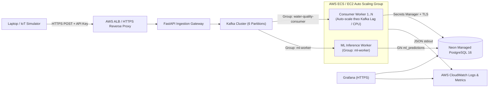

# Lộ trình nâng cấp Bài tập lớn (BTL): Cloud-Native Elasticity & ML Worker

Tài liệu này mô tả lộ trình chuyển tiếp trực tiếp từ **Seminar MVP (`water-quality-cloud/`)** lên **Bài tập lớn hoàn chỉnh** theo đúng định hướng đã chốt: **Cloud-native & Elasticity thật + ML Worker nhẹ cho `BOD ATU` & `Ammonia(N)`**.

Kiến trúc Seminar hiện tại đã đặt sẵn 4 nền móng để BTL không phải viết lại từ đầu:
1. Kafka topic chia sẵn **multi-partition** (tăng từ `3` lên `6` partitions, partition key = `station_id`).
2. Consumer đọc cấu hình 100% qua biến môi trường (12-Factor) và log JSON ra `stdout`.
3. Neon PostgreSQL đã có sẵn bảng **`ml_predictions`**.
4. Producer tách biệt ở Client Edge, dễ chuyển sang HTTPS API khi cần.

---

## Kiến trúc mục tiêu cho BTL

---

## 4 Trụ cột nâng cấp trong BTL

### Trụ cột 1 — Infrastructure as Code (Terraform)
Tạo thư mục `infra/terraform/` quản lý toàn bộ tài nguyên AWS thay vì bấm tay trên Console:
- VPC, Public/Private Subnets, Security Groups chuẩn nguyên tắc tối thiểu đặc quyền.
- AWS Secrets Manager lưu `DATABASE_URL` và `GRAFANA_ADMIN_PASSWORD`.
- AWS CloudWatch Log Group (`/water-quality/consumer`, `/water-quality/ml-worker`) và CloudWatch Alarms.
- ECS Cluster + Task Definitions + Auto Scaling Policy (hoặc EC2 Launch Template + ASG).

### Trụ cột 2 — Elasticity thật & Benchmark Scale-out
- Nâng `KAFKA_PARTITIONS=6` trên topic `water-quality-events`.
- Triển khai **ECS Service Auto Scaling** (hoặc custom CloudWatch metric đẩy `kafka_consumer_group_lag` mỗi 30 giây):
  - Khi Producer đẩy tải cao (ví dụ 500–1.000 evt/s kèm sleep mô phỏng xử lý CPU nặng hơn hoặc batch timeout), Consumer lag vượt ngưỡng → AWS tự động scale từ **1 → 3 → 6 Consumer tasks** trong cùng `water-quality-consumer` group.
  - Khi ngừng burst, AWS tự động scale-in về `1` task để tiết kiệm chi phí.
- **Thí nghiệm bắt buộc trong báo cáo BTL**: Biểu đồ **Elasticity Timeline** (trục X = thời gian; trục Y = `Producer Rate`, `Consumer Lag`, `Active Consumer Count`, `DB Throughput`) chứng minh hệ thống tự giảm lag về 0 nhờ scale-out mà không rớt hoặc trùng bản ghi.

### Trụ cột 3 — Bảo mật Production & Observability
- **Loại bỏ phụ thuộc SSH Tunnel khi demo nhiều client**: Thêm `FastAPI Ingestion Gateway` đứng sau HTTPS (Caddy / Nginx + Let's Encrypt hoặc AWS ALB) xác thực bằng `X-API-Key` / Bearer token, đẩy vào Kafka nội bộ (hoặc bật Kafka `SASL_SSL`).
- **Quản lý bí mật chuẩn Cloud**: Chuyển `.env` sang **AWS Secrets Manager** (ECS inject trực tiếp vào biến môi trường lúc khởi động container).
- **Observability hợp nhất**: Đẩy log JSON từ `consumer/app/main.py` vào **AWS CloudWatch Logs**; tạo thêm Grafana panel theo dõi CPU/RAM container + Kafka Consumer Lag song song với chất lượng nước.

### Trụ cột 4 — Sửa & tích hợp ML Worker nhẹ (`BOD ATU`, `Ammonia(N)`)
Qua kiểm tra mã nguồn hiện có trong `Đánh giá mô hình/`:
- `offline-model.py` dùng `RandomForestRegressor` với `bod_lag_1, bod_lag_2, bod_lag_3, easting, northing` (chạy batch tĩnh từng trạm).
- `online-model.py` hiện **chỉ đưa mỗi `timestamp` chuẩn hóa Welford vào `SGDRegressor`**, khiến `R² < 0` trên toàn bộ 1.517 trạm trong `ONLINE_SGD_BOD_ATU_metrics_all_stations_sorted.csv` (vì nồng độ BOD không phụ thuộc tuyến tính vào thời gian tuyệt đối!).

**Cách nâng cấp đúng & nhẹ cho BTL**:
1. Giữ nguyên pipeline chính (`water-quality-consumer`), **tạo thêm dịch vụ `ml-worker/`** chạy với consumer group riêng (`KAFKA_CONSUMER_GROUP=ml-worker`), không làm chậm đường ghi dữ liệu thô (`water_measurements`).
2. `ml-worker` lọc sự kiện `BOD ATU` và `Ammonia(N)`, duy trì sliding buffer 3 mẫu gần nhất theo `station_id` (lấy từ RAM + warm-up từ Neon DB khi restart) để tạo vector đặc trưng hợp lệ:
   - `lag_1`, `lag_2`, `lag_3`
   - `rolling_mean_3`, `delta_1_2`
   - `sin(month)`, `cos(month)` (tính mùa vụ thay cho raw timestamp)
3. So sánh trực tiếp trên cùng dữ liệu 2025:
   - Offline Random Forest (`offline-model.py` làm chuẩn đối chiếu) vs Online `SGDRegressor` / `River` đã sửa feature lag + mùa vụ.
   - Dự đoán giá trị kế tiếp và điền khuyết khi trạm bị mất mẫu (`NO FLOW/SAMP`), ghi kết quả vào bảng **`ml_predictions`** đã tạo sẵn từ Seminar.
4. Hiển thị đường **Actual vs ML Predicted** trên một row panel mới trong Grafana dashboard `water-quality-monitoring.json`.
